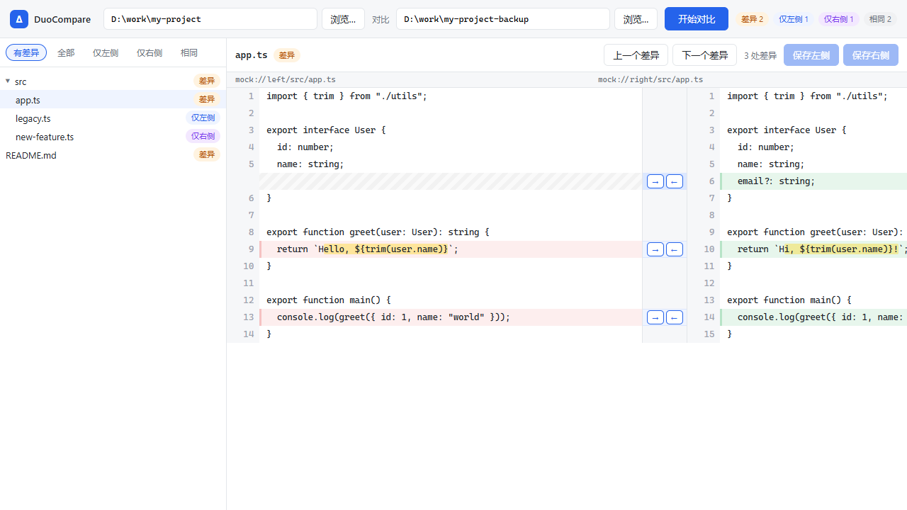

# DuoCompare

开源的代码对比与手动合并工具，[Beyond Compare](https://www.scootersoftware.com/) 的免费替代。

为程序员的日常场景而设计：**对比两个文件夹、并排查看代码差异、逐块手动合入改动**。轻量、跨平台、离线可用。



## 功能特性

### 文件夹对比

- 递归扫描两个目录，按**文件内容逐字节比较**（不是只看时间戳），准确识别真实差异
- 目录树展示每个文件/文件夹的状态：`相同` / `差异` / `仅左侧` / `仅右侧`
- 按状态过滤（有差异 / 全部 / 仅左侧 / 仅右侧 / 相同），快速聚焦关心的文件
- 顶部统计栏汇总各类文件数量
- 自动跳过 `.git` 版本库元数据

### 文件对比

- 并排双栏差异视图，行号严格对齐
- 变更块红（左）/ 绿（右）着色，未变化行以斜纹填充占位，一眼看清上下文
- **行内字符级高亮**：同一行里只有几个字符不同时，精确标出差异位置
- 「上一个差异 / 下一个差异」快速跳转，大文件也不用滚动找
- 自动识别二进制 / 非 UTF-8 文件并跳过文本对比

### 手动合并

- 每个差异块中央的 **→ / ←** 按钮，一键把整块内容复制到另一边
- 合并结果即时重排差异，剩余差异数实时更新
- 有未保存改动时明确提示「左侧/右侧未保存」，确认无误后一键保存
- 完整保留文件的换行风格与结尾换行

## 下载与安装

从 [Releases](../../releases) 页面下载：

| 资产 | 说明 |
| --- | --- |
| `DuoCompare_x.x.x_x64-setup.exe` | Windows 安装版（开始菜单 + 卸载项） |
| `duocompare.exe` | 绿色版，单文件直接运行 |

**系统要求**：Windows 10/11（需 [WebView2 运行时](https://developer.microsoft.com/microsoft-edge/webview2/)，Win10/11 一般自带）。macOS / Linux 构建方式见下文。

## 快速开始

1. 启动 DuoCompare
2. 顶部左右两个输入框分别填入（或点「浏览…」选择）要对比的两个文件夹
3. 点「开始对比」，左侧出现目录树
4. 点击任意文件，右侧显示并排差异
5. 用差异块中间的 **→ / ←** 决定采用哪边的内容
6. 点「保存左侧 / 保存右侧」写入文件

## 技术架构

| 层 | 技术 | 说明 |
| --- | --- | --- |
| 对比引擎 | Rust（[`similar`](https://crates.io/crates/similar)） | 独立 crate `duocompare-core`，无 UI 依赖，可复用于 CLI / 服务端 |
| 桌面壳 | [Tauri 2](https://tauri.app/) | 轻量跨平台，产物体积小（安装包约 2 MB） |
| 界面 | React + TypeScript + Vite | 并排 diff 渲染与合并交互 |

```
├── core/           对比核心（纯 Rust）
│   └── src/
│       ├── dir.rs      目录递归对比，状态聚合
│       ├── diff.rs     行级差异（Myers 算法，删除+插入合并为替换）
│       └── fs.rs       文件逐字节比较 / 文本读写 / 二进制识别
├── src-tauri/      Tauri 应用壳
│   └── src/lib.rs      IPC 命令：compare_dirs / load_file_diff / save_file
└── src/            React 前端
    ├── components/     目录树、并排差异视图
    ├── diff.ts         前端差异对齐（合并后即时重排）
    └── mock.ts         浏览器演示模式示例数据
```

核心设计：前后端采用**一致的行切分规则**（按 `\n` 切分、保留 `\r`、记录结尾换行标记），保证 Rust 计算的行号与前端渲染严格对齐，保存时无损还原原文。

## 开发指南

### 环境要求

- [Rust](https://rustup.rs/)（stable）
- Node.js 18+
- Windows 上需 WebView2 Runtime（Win10/11 自带）

### 常用命令

```bash
npm install                # 安装前端依赖
npm run tauri dev          # 桌面应用开发模式（热更新）
npm run dev                # 浏览器演示模式（无需 Tauri，自动加载示例数据）
cargo test --workspace     # 运行 Rust 单元测试
npm run build              # TypeScript 检查 + 前端构建
npm run tauri build        # 打包发布产物（exe / msi / nsis）
```

### 浏览器演示模式

`npm run dev` 后打开 `http://localhost:5173`，会自动加载一组示例数据，可在纯浏览器里体验完整的对比与合并流程——前端代码不依赖 Tauri API 也能运行，方便做 UI 开发和截图。

### 发布打包

```bash
npm run tauri build
```

产物位于 `target/release/`：`duocompare.exe`（绿色版）与 `target/release/bundle/`（msi / nsis 安装包）。

> **注意**：`target/debug/` 下的开发版 exe 运行时依赖本地 vite 开发服务器，复制到其他机器会显示「无法访问此页面」。分发请一律使用 `npm run tauri build` 产出的 release 版本。

## Roadmap

- 语法高亮（按语言着色）
- 三方合并与 git 冲突处理
- 忽略规则（glob 过滤，如 `node_modules`、`*.min.js`）
- 文本 / 图片 / 二进制的专门对比视图
- 会话管理（保存常用对比对）
- 快捷键体系
- 大文件虚拟滚动性能优化
- CLI（复用 `duocompare-core`）
- macOS / Linux 打包

## 贡献

欢迎 Issue 和 Pull Request。开始前建议先开 Issue 讨论方向，避免重复劳动。

开发约定：

- Rust 侧改动请附带单元测试，提交前保证 `cargo test --workspace` 全绿
- 前端改动保证 `npm run build` 通过（含 TypeScript 严格检查）
- commit message 请用中文或英文清楚描述改动动机

## License

[MIT](LICENSE)
